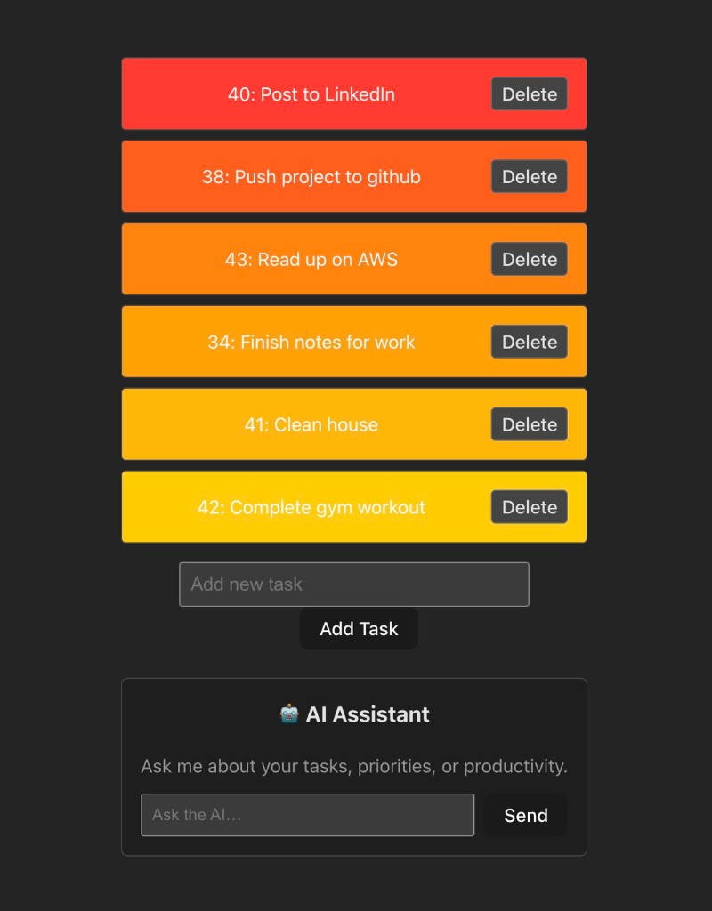

# ClearWeb

ClearWeb is a web version of the [Clear](https://www.useclear.com/) iOS app. I wanted that same short, colored task list at work, where I cannot use the phone app, and I wanted an excuse to build a small .NET API.

The list is one column. The most important task is red, and the color cools toward yellow as you move down. Drag a row to reorder it. An assistant at the bottom can see the current list and answer questions about it.

Try it at [https://clear-web-xi.vercel.app/](https://clear-web-xi.vercel.app/).



There are no accounts. At this time it's just one list since I use it for personal use. In the future can accommodate for multiple lists. The assistant uses a free Gemini key, so chat can stop for the day if that quota runs out. Adding and reordering tasks still works.

## What it does

- Shows every task in priority order, colored from red through orange to yellow
- Adds a task at the end of the list
- Deletes a task
- Reorders tasks by dragging
- Sends the current list to Gemini when you ask the assistant a question

## Stack

- React and Vite for the interface
- ASP.NET Core 10 for the API
- PostgreSQL for the task list
- Google Gemini for the assistant
- The site is hosted on Vercel. The API and database are hosted on Railway.

## Run it locally

You need Node, the .NET 10 SDK, and PostgreSQL.

Create the database and table:

```sql
CREATE DATABASE clearweb;

CREATE TABLE tasks (
  id SERIAL PRIMARY KEY,
  name TEXT NOT NULL,
  position INTEGER NOT NULL
);
```

In `server/appsettings.json`, set `DefaultConnection` to your own Postgres user:

```text
Host=localhost;Port=5432;Username=YOUR_USER;Database=clearweb
```

Start the API from `server`:

```bash
dotnet run
```

It listens on `http://localhost:5149`.

For the assistant, export a [Google AI Studio](https://aistudio.google.com/apikey) key in that same terminal before starting the API:

```bash
export GOOGLE_API_KEY="your-key"
```

In `client/.env`:

```text
VITE_API_URL=http://localhost:5149
```

Start the site from `client`:

```bash
npm install
npm run dev
```

Open `http://localhost:5173`.

## Deploy

The React app deploys to Vercel with `VITE_API_URL` set to the public API origin and no trailing slash. Vite reads that value at build time, so the site has to be redeployed after the value changes.

The API deploys from the `server` directory with `server/DockerFile`. Railway also runs Postgres. The API service needs:

- `DATABASE_URL` as an Npgsql connection string, with `SSL Mode=Disable` on Railway's private network
- `AllowedOrigins__0` set to the Vercel origin, `https://clear-web-xi.vercel.app`
- `GOOGLE_API_KEY` for the assistant

The Railway database needs the same `tasks` table as local development.
